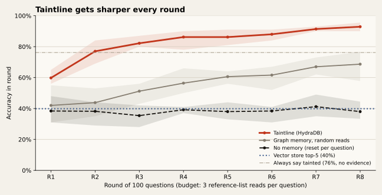

# Taintline

**Your agent cited a clean paper. That paper cited a retracted one.**

Taintline is a self-improving citation graph on [HydraDB](https://github.com/hydra-db/hydradb). It answers one question for research agents: *does this paper's evidence chain lead to retracted work?* It always answers with the citation path, `paper -> bridge -> retracted`, in about 57 tokens.

- **Track:** 1, the self-improving graph (HydraDB Hackathon, Nov 14–16 2026)
- **Live demo:** https://taintline-sama-5806.vercel.app (a precomputed replay of a real HydraDB run; see [Live mode](#live-mode))
- **Builder:** Demir, solo



## Results

These numbers come from a real OpenAlex snapshot: 790 question papers, 210 retracted COVID-19-era works and 1,385 works with full reference lists. Questions run in rounds of 100, over 5 shuffled orders. Each answer may read at most 3 extra reference lists.

| Approach | Accuracy | Final round | Recall (tainted) | Precision | Reference lists read / q | Context tokens / answer |
|---|---:|---:|---:|---:|---:|---:|
| **Taintline (HydraDB)** | 82.8% | 92.9% | 77.5% | 100.0% | 2.20 | 57 |
| Graph memory, random reads | 56.2% | 68.7% | 42.6% | 100.0% | 2.94 | ≈ same |
| No memory (reset per question) | 38.4% | 38.0% | 19.1% | 100.0% | 3.53 | ≈ same |
| Taintline + own-verdict ranking (ablation) | 81.5% | 92.7% | 75.8% | 100.0% | 2.24 | ≈ same |
| Vector store, top-5 (bge-small) | 39.9% | — | 31.9% | 74.7% | 0 | 1,813 |
| Vector store, top-10 (bge-small) | 47.2% | — | 49.8% | 72.3% | 0 | 3,637 |
| Always say "tainted" | 76.2% | — | 100% | 76.2% | 0 | no evidence |
| Full crawl, no budget | 100% | 100% | 100% | 100% | 61.2 | — |

- Graph rows are means over 5 question orders, computed with the in-memory reference store. The HydraDB run below reproduces order 1 answer for answer.
- **The curve rises:** accuracy goes from 59.8% in round 1 to 92.9% in round 8 at the same budget. With no memory it stays flat.
- **Every flag is checkable:** precision is 100% in every run, because "tainted" is only ever said with a real path.
- **Live HydraDB run:** the same 790 questions on a local HydraDB node built **44,988 nodes / 52,792 CITES edges**, accuracy 84.0%, with **0 answer mismatches** against the in-memory reference (91 s end to end, writes included).
- **Under load:** 32 concurrent clients for 30 s against one local graph-node: **228 queries/s**, p50 152 ms, p95 578 ms, p99 1053 ms per operation, **0 errors** in 4,585 operations (an operation is the 2-query path check or the frontier query; 8 vCPU box, dev build settings).

Reproduce everything with `PYTHONPATH=. python -m taintline.bench --hydra`. Raw outputs are in `results/bench.json` and `results/load.json`.

## How it improves itself

1. **Seed.** The graph starts with only the public retraction list. Each retracted work is a `:Work:Retracted` node.
2. **Ingest the gap.** A question reads the paper's reference list (one fetch) and writes it as `CITES` edges with one batched `UNWIND`.
3. **Ask the graph.** One traversal checks for a retraction within two citations:
   ```cypher
   MATCH (q:Work {id: $q})-[:CITES]->(x:Work)-[:CITES]->(r:Retracted)
   RETURN x.id AS via, r.id AS rid
   ```
4. **Expand where the graph points.** If there is no path yet, HydraDB ranks the unread references by how many already-ingested papers cite them. Taintline reads the top one and asks again, up to the budget:
   ```cypher
   MATCH (q:Work {id: $q})-[:CITES]->(x:Work)<-[:CITES]-(p:Work)
   WHERE x.fetched = 0
   RETURN x.id AS id, sum(p.verdict) AS score, count(*) AS citers
   ```
5. **Keep everything.** Every list it reads stays in the graph, and its verdict is written back onto the paper. The next question in the same area starts closer to the answer. That is gap-driven ingestion steered by the graph's own structure, and it is why accuracy rises at a constant cost.

**Ablations (honest):**
- Reading at random from the same remembered graph rises much more slowly (`memory_random`).
- Resetting the graph per question stays flat (`cold`).
- Adding Taintline's own verdicts to the ranking (+3 per citer it judged tainted) gave no measurable gain (`taintline_verdict`), so it is off by default.

## Why not a vector store?

Contamination is a fact about citation edges, not about wording. A vector store finds papers that *sound like* retracted work:

- It flags honest papers on the same topic.
- It misses chains through a bridge paper that uses different words.
- When top-5 vector retrieval surfaces a retracted paper, that paper is in the question's real citation chain only **10%** of the time.
- It costs **1,813 tokens** of abstracts per answer, against **57** for Taintline's path.

A full crawl with no budget is always right, but it reads **61 reference lists per question**. Taintline reads **2.2**.

## Why HydraDB specifically

- The two decisions that matter, "is there a path?" and "what should I read next?", are both single Cypher traversals on HydraDB.
- Ingestion is batched `UNWIND` (≤1000 rows per request).
- Verdicts are written back as node properties, so the graph's memory *is* the database. There is no side cache.
- **Lesson learned:** filtering the endpoint by a `:Retracted` label instead of a property (`r.retracted = 1`) made the two-hop query about 45× faster (3.1 s → 68 ms on 45k nodes). That label is what makes the load numbers possible.
- Results are paginated (`page_size` 4096, following `next_cursor`) so large scans are never silently truncated.

## Go-to-market

| | |
|---|---|
| **Who pays** | Research-integrity teams at publishers and journals, systematic-review groups, pharma medical-affairs and regulatory writers, and teams shipping AI research agents and literature-review copilots. |
| **Pain** | Retraction notices sit on the retracted paper only. Retraction Watch lists 50k+ retractions (open via Crossref since 2023), and retracted COVID-19 papers kept being cited for years. Nobody warns about the papers built on top of them. |
| **Wedge** | A `check(doi)` tool for agents: a verdict plus path in under 100 tokens. It drops into any tool-calling agent or a manuscript-submission check. |
| **Pricing** | Free: 100 checks/month. Pro $49/month: 10k checks, plus webhook alerts when a paper you cite gains a newly retracted ancestor. Publisher plan from $1,500/month: bulk manuscript screening, audit export and an SLA. |
| **Moat** | Every check enriches the shared graph, so each customer's questions make the next answer cheaper and faster. That is the curve above, as a business. |

## Run it

### 1. Benchmark without HydraDB (in-memory reference store)
```bash
python3 -m venv .venv && .venv/bin/pip install -r requirements.txt
PYTHONPATH=. .venv/bin/python -m pytest -q
PYTHONPATH=. .venv/bin/python -m taintline.bench          # memory strategies + vector baseline
```

### 2. With HydraDB
HydraDB is self-hosted from source (no hosted API). On Ubuntu 24.04, follow its README. On Debian 13, `libcypher-parser` comes from the Ubuntu noble `.deb`s.
```bash
git clone https://github.com/hydra-db/hydradb && cd hydradb
sudo bash scripts/install_lagraph.sh /opt/lagraph
LAGRAPH_LIB_DIR=/opt/lagraph/lib cargo build --release --locked --features server-runtime --bin graph-node
cd ../taintline
HYDRADB_BIN=../hydradb/target/release/graph-node ./run_hydradb.sh &    # plaintext dev node, random token in .hydradb/
PYTHONPATH=. .venv/bin/python -m taintline.bench --hydra               # full run + parity check vs memory
PYTHONPATH=. .venv/bin/python -m taintline.loadtest --workers 32 --seconds 30
PYTHONPATH=. .venv/bin/python -m taintline.plot
```
`run_hydradb.sh` generates a random auth token in `.hydradb/auth-token` (git-ignored). The client reads it from that file and never prints it.

### Live mode
Check any OpenAlex work against the real API, using the running HydraDB graph:
```bash
OPENALEX_API_KEY=... PYTHONPATH=. .venv/bin/python -m taintline.live W3010930696 --budget 3
```

### Web demo
`web/` is a dependency-free static site that reads `web/data/*.json`; run `python scripts/scripts_finalize.py` to copy them from `results/`. Serve it with `python3 -m http.server -d web`.

## Layout
```
taintline/world.py     snapshot loader; fetch() is the only way to learn references (metered)
taintline/store.py     HydraStore (HTTP Cypher) and MemoryStore (same contract)
taintline/engine.py    budgeted gap-driven ingestion + graph-ranked frontier
taintline/vector.py    bge-small vector baseline
taintline/bench.py     benchmark, ablations, budget sweep, HydraDB parity
taintline/loadtest.py  concurrent read load on HydraDB
taintline/live.py      live OpenAlex mode
web/                   demo site (scripts/scripts_build_web.py bundles it into dist/ for Vercel)
scripts/               snapshot fetch (7 OpenAlex calls), README number fill, web bundle
```

## Honest limits
- The "world" is a frozen OpenAlex snapshot. Ground truth is "a retraction within two citations *inside the snapshot*"; works outside it are treated as having no references.
- Questions were sampled as citers of papers that cite retracted COVID-19 work, plus 188 same-topic papers with no such path, so 76% are tainted. Always answering "tainted" scores 76% with no evidence. Taintline passes that by round 2 and every flag carries its path.
- Two hops only. Deeper chains are a parameter, not built yet.
- The public site is a precomputed replay. A HydraDB node needs a container host, and the free hosts we could use need a new account.

## Credits and licenses
- Data: [OpenAlex](https://openalex.org) (CC0). Retraction flags in OpenAlex come from Retraction Watch via Crossref.
- Graph database: [HydraDB](https://github.com/hydra-db/hydradb) (Elastic License 2.0), used unmodified as a separate server.
- Embeddings for the baseline: [fastembed](https://github.com/qdrant/fastembed) with BAAI/bge-small-en-v1.5 (MIT). Token counts: tiktoken `cl100k_base`.
- Fonts: Fraunces, Inter and IBM Plex Mono (SIL OFL) via Google Fonts.
- Code: MIT, see `LICENSE`.
